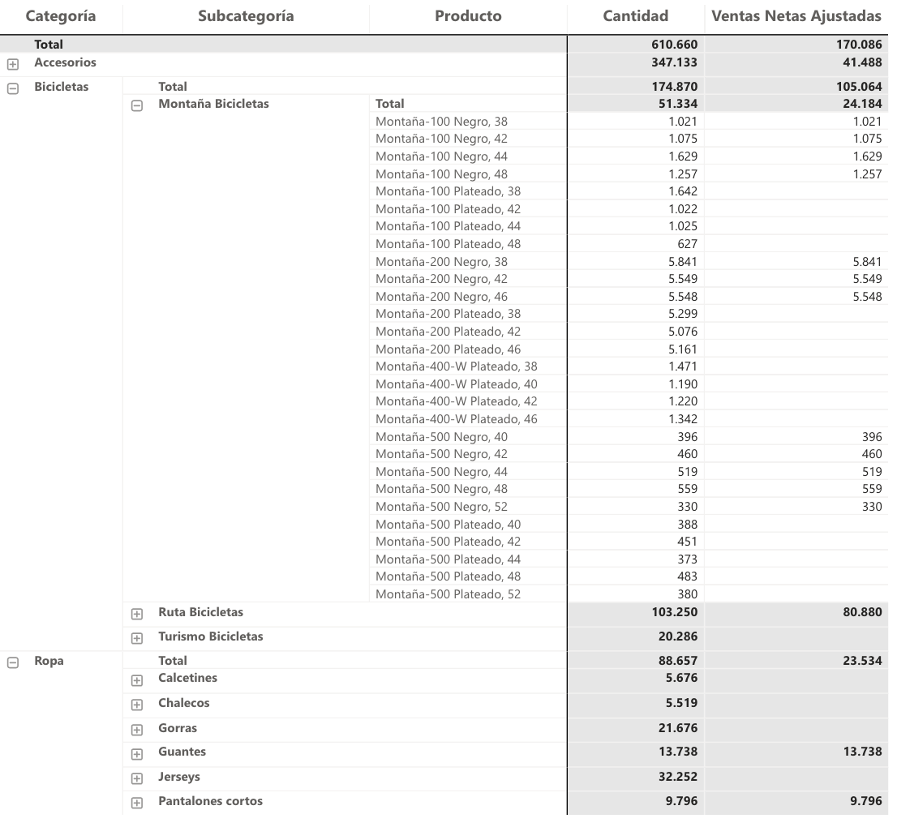

## Lógica condicional a nivel de producto en una matriz con jerarquía

Cuando una regla de negocio se decide producto a producto pero el informe muestra categorías y subcategorías, hay que calcular la regla en el nivel de producto y después sumar. Si la aplico directamente, Power BI la evalúa sobre el agregado de la categoría y el resultado cambia.

### El caso

Matriz Categoría → Subcategoría → Producto, con dos medidas base:

```DAX
Cantidad = SUM ( Ventas[Cantidades] )
```

```DAX
Ventas Color =
CALCULATE ( [Cantidad], dim_Producto[Color] IN { "Rojo", "Negro" } )
```

La regla: para cada producto, contar sus unidades rojas o negras, pero ignorar los productos con cantidades negativas (devoluciones netas) para que no resten al total de la categoría.

### La medida

```DAX
Ventas Netas Ajustadas =
VAR TablaProducto =
    ADDCOLUMNS (
        SUMMARIZE ( Ventas, dim_Producto[Categoría], dim_Producto[Subcategoría], dim_Producto[Producto] ),
        "@Resultado",
            VAR vTotal = [Cantidad]
            VAR vColor = [Ventas Color]
            RETURN IF ( vTotal > 0 && vColor > 0, MIN ( vColor, vTotal ) )
    )
RETURN
    SUMX ( TablaProducto, [@Resultado] )
```

1. SUMMARIZE crea una fila por producto con ventas en el contexto actual.
2. ADDCOLUMNS evalúa la regla en cada fila. La transición de contexto hace que `[Cantidad]` y `[Ventas Color]` se calculen para ese producto.
3. SUMX suma los resultados. En la fila de categoría, el valor es la suma de las decisiones por producto, no una decisión sobre el total.

Uso ADDCOLUMNS sobre SUMMARIZE en lugar de meter la columna calculada dentro de SUMMARIZE. Funciona igual en casos simples, pero SUMMARIZE con columnas calculadas puede dar resultados inesperados y SQLBI lo desaconseja expresamente.



### Por qué no basta con un IF

```DAX
-- Así NO
Ventas Netas Ajustadas (mal) =
IF ( [Cantidad] > 0 && [Ventas Color] > 0, MIN ( [Ventas Color], [Cantidad] ) )
```

En la fila de producto da lo mismo. En la fila de categoría compara los totales de la categoría: si un producto tiene −50 y otro +200, el IF ve +150 y deja pasar el negativo. La versión con tabla virtual lo descarta.
