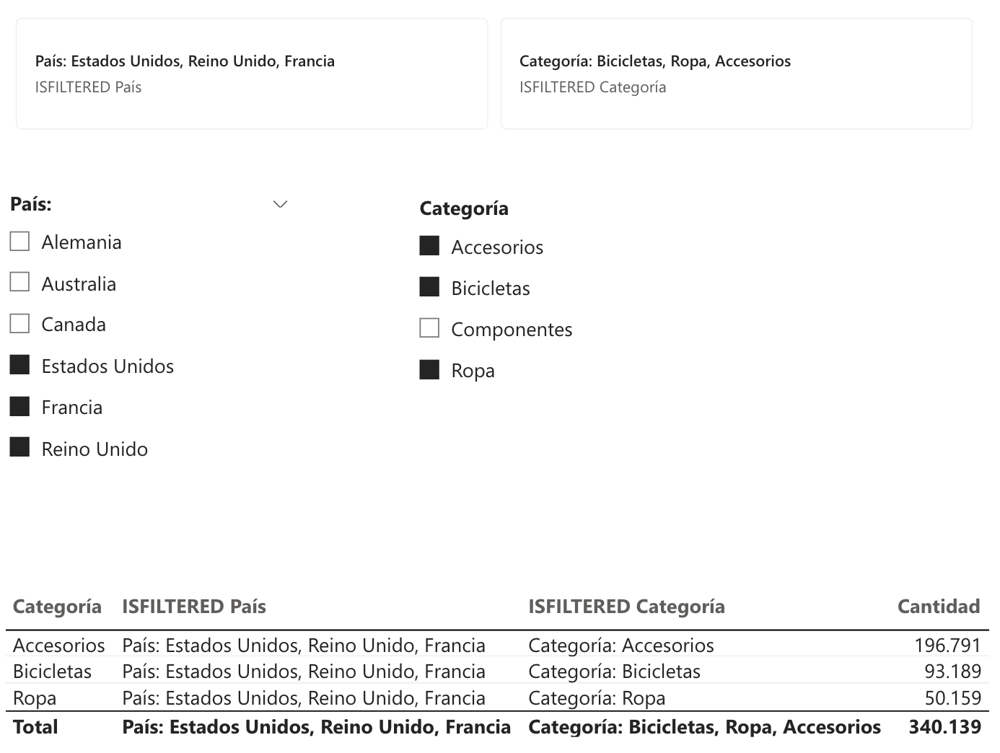

## Encabezados dinámicos con ISFILTERED

Un director abre el informe, ve "Ventas: 2,3 M€" y pregunta: ¿esto es de todas las regiones o solo de alguna? Si el título no lo dice, la cifra no vale.

Los encabezados dinámicos resuelven eso: el título cambia según los filtros activos.

- Sin filtros, título genérico.
- Con filtros, el título nombra la selección.

```DAX
Título País =
IF (
    ISFILTERED ( dim_Clientes[País] ),
    "País: " & CONCATENATEX ( VALUES ( dim_Clientes[País] ), dim_Clientes[País], ", " ),
    "Todos los países"
)
```

```DAX
Título Categoría =
IF (
    ISFILTERED ( dim_Producto[Categoría] ),
    "Categoría: " & CONCATENATEX ( VALUES ( dim_Producto[Categoría] ), dim_Producto[Categoría], ", " ),
    "Todas las categorías"
)
```

La medida se asigna al título del visual desde **Formato → Título → fx**.



Si el usuario selecciona 40 países, el título se vuelve ilegible. En producción limito la lista: a partir de 3 valores muestro "País: 40 seleccionados" con `COUNTROWS ( VALUES ( ... ) )`.

La explicación de cómo funciona ISFILTERED (y qué no detecta) está en [ISFILTERED](<../../Avanzado/ISFILTERED/>).
