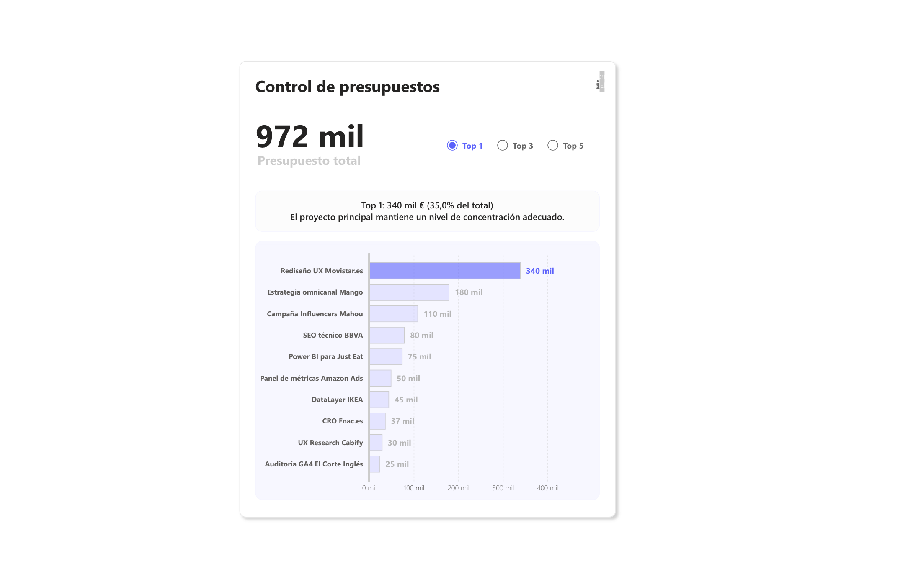

# Proyecto: Control de Presupuestos

Un widget que responde una pregunta concreta: ¿el presupuesto está concentrado en pocos proyectos o repartido? El usuario elige Top 1, 3 o 5 y el widget resalta esos proyectos, calcula su peso y escribe un diagnóstico.



### Qué hace

#### 1. Gráfico de barras

  - Muestra el presupuesto por proyecto.

  - Puedes elegir si quieres ver el Top 1, Top 3 o Top 5 de proyectos en un segmentador.

  - Los proyectos del Top elegido se pintan en morado intenso y el resto en morado claro.

#### 2. Tarjetas

  - Una tarjeta te da los datos globales del Top que hayas seleccionado.

  - Otra tarjeta te recuerda el total general, para que veas la proporción que representa el Top sobre el conjunto.


#### 3. Diagnóstico automático

  - Según el peso del Top sobre el total, una frase clasifica la situación:

    - Si pesa demasiado, riesgo de dependencia.

    - Si pesa poco, alta dispersión.

    - Entre medias, concentración equilibrada.


### Cómo está hecho:

#### 1. Preparar la base de datos y medidas principales

La medida base:

```
Total Presupuesto = SUM(Proyectos[Presupuesto (€)])
```

#### 2.  Crear el ranking de proyectos

Ranking de proyectos por presupuesto:

```DAX
Ranking Presupuesto = 
RANKX(
    ALL(Proyectos[Proyecto]),
    [Total Presupuesto],
    ,
    DESC
)
```

#### 3. Tabla desconectada para el segmentador

Para permitir que el usuario elija Top 1, 3 o 5, creamos una tabla desconectada:

```
Ranking Presupuestos = GENERATESERIES(1, 5, 1)
```

  - Genera una serie de números del 1 al 5.

  - Esta tabla no tiene relación con la tabla de proyectos, por eso se llama desconectada.


En el segmentador también puedes mostrar un nombre más amigable:

```
Nombre Parametro = "Top " & 'Ranking Presupuestos'[Ranking Presupuestos]
```

#### 4. Colorear las barras según el Top N seleccionado

Ahora queremos que el Top N se vea más destacado en el gráfico de barras.

```
Color Barra = 
VAR SeleccionarTopN = SELECTEDVALUE('Ranking Presupuestos'[Ranking Presupuestos])
RETURN
IF([Ranking Presupuesto] <= SeleccionarTopN, "#5b5cff99", "#5b5cff20")
```

`Texto Color` hace lo mismo para el color de la etiqueta:

```DAX
Texto Color = 
VAR SeleccionarTopN = SELECTEDVALUE('Ranking Presupuestos'[Ranking Presupuestos])
RETURN
IF([Ranking Presupuesto] <= SeleccionarTopN, "#5b5cff", "#b5b5b5")
```

#### 5. Crear la narrativa automática del Top N

La medida que escribe el diagnóstico. Los umbrales (25-40 % para el Top 1, 55-70 % para el Top 3, 70-85 % para el Top 5) son una decisión de negocio, no estadística: los fijé para este caso y en un proyecto real los acordaría con quien use el informe.

```
Narrativa TopN = 
VAR SeleccionarTopN = INT( SELECTEDVALUE('Ranking Presupuestos'[Ranking Presupuestos], 3) )
VAR TotalPresupuesto = [Total Presupuesto]
VAR SinDatos = ISBLANK(TotalPresupuesto) || TotalPresupuesto = 0

VAR TableTopN =
    TOPN(
        SeleccionarTopN,
        ALLSELECTED('Proyectos'[Proyecto]),
        [Total Presupuesto],
        DESC
    )

VAR TopNSales = SUMX(TableTopN, [Total Presupuesto])
VAR SalesPercentage = DIVIDE(TopNSales, TotalPresupuesto, BLANK())

VAR RangoInferior = 
    SWITCH( SeleccionarTopN,
        1, 0.25,
        3, 0.55,
        5, 0.70
    )

VAR RangoSuperior =
    SWITCH( SeleccionarTopN,
        1, 0.40,
        3, 0.70,
        5, 0.85
    )

VAR Diagnostico =
    SWITCH(
        TRUE(),
        SinDatos, "No hay datos suficientes.",
        ISBLANK(RangoInferior) || ISBLANK(RangoSuperior), "Rango no definido.",
        SalesPercentage < RangoInferior, 
            SWITCH( SeleccionarTopN,
                1, "El proyecto principal tiene una aportación reducida. Alta dispersión.",
                3, "Los 3 mayores no alcanzan una masa crítica suficiente.",
                5, "Los 5 principales muestran baja representatividad."
            ),
        SalesPercentage > RangoSuperior,
            SWITCH( SeleccionarTopN,
                1, "Un único proyecto concentra un peso excesivo. Riesgo elevado.",
                3, "Alta concentración en pocos proyectos. Dependencia significativa.",
                5, "Concentración excesiva en los 5 principales."
            ),
        SWITCH( SeleccionarTopN,
            1, "El proyecto principal mantiene un nivel de concentración adecuado.",
            3, "Los 3 mayores representan una concentración equilibrada.",
            5, "Los 5 principales aportan un peso representativo y razonable."
        )
    )

RETURN
IF(
    SinDatos,
    "Top " & SeleccionarTopN & ": Datos insuficientes",
    "Top " & SeleccionarTopN & ": " &
    FORMAT( TopNSales / 1000, "#,0" ) & " mil €" &
    " (" & FORMAT(SalesPercentage, "0.0%") & " del total)" &
    UNICHAR(10) & Diagnostico
)
```

- TOPN selecciona los proyectos más grandes según el Top N elegido.

- SalesPercentage calcula qué porcentaje del total representan.

- RangoInferior/RangoSuperior define si la concentración es baja, equilibrada o alta.


Un detalle: el slicer ofrece del 1 al 5 (`GENERATESERIES ( 1, 5, 1 )`), pero la narrativa solo tiene umbrales para 1, 3 y 5. Con 2 o 4 devuelve "Rango no definido". Lo correcto es limitar la tabla del slicer a `{ 1, 3, 5 }` o definir umbrales para todos.


#### Combinar todo en el gráfico y las tarjetas

- El gráfico de barras usa Color Barra y Texto Color para diferenciar los proyectos según el Top N.

- Una tarjeta dinámica muestra los totales del Top N seleccionado (usando Narrativa TopN).

- Otra tarjeta muestra el total general para comparar rápidamente.

De un vistazo, el usuario ve:

- Qué proyectos destacan

- Qué proporción del total representan

- Si la distribución es equilibrada o riesgosa


--- 

El `.pbix` está en esta misma carpeta.
